### 🛠 Tech Stack

**Languages** 

**Backend & Database** 

**Frontend** 

### 🌱 Currently Learning
- Operating Systems
- Data Structures & Algorithms in C
- Backend Development

### ⏰ When I Code

<picture>
  <source media="(prefers-color-scheme: dark)" srcset="./commit-clock.svg">
  
</picture>

### 📫 Contact

